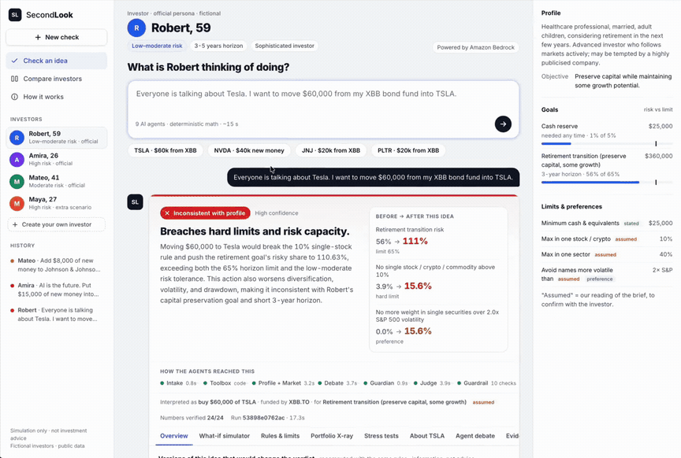

# SecondLook demo video

**PolyFinances Datathon 2026 · AlphaForge AI · Team 10**

[Download the full narrated walkthrough (MP4, 4:52)](https://github.com/Eric0730-04/polyfinances-datathon-2026/releases/download/demo-video/secondlook-demo.mp4)

The complete video demonstrates SecondLook's investor workflow, from an investment idea to a consistency verdict, explanations, follow-up questions, and the evidence behind the answer.

## Find a feature

Approximate timestamps in the full video:

| Time | Demonstration |
| --- | --- |
| 00:35 | Check an investment idea against Robert's profile, constraints, and risk capacity. |
| 01:15 | Inspect alternative amounts and conditions that would change the verdict. |
| 02:05 | Ask a follow-up question and see the computed implications. |
| 03:05 | Compare the same idea across different investor personas. |
| 04:15 | Review numeric grounding, agent execution, and the saved audit trace. |

## Video files

| File | Format | Size | Purpose |
| --- | --- | --- | --- |
| [secondlook-demo.mp4](https://github.com/Eric0730-04/polyfinances-datathon-2026/releases/download/demo-video/secondlook-demo.mp4) | H.264 video + AAC audio, 1440 × 970, 15 fps | About 10 MB | Complete recording in a browser-compatible format. |
| [secondlook-demo-original.mp4](https://github.com/Eric0730-04/polyfinances-datathon-2026/releases/download/demo-video/secondlook-demo-original.mp4) | Original HEVC video + AAC audio, 1602 × 1080, 30 fps | About 173 MB | Original recording at its supplied quality. |

The preview above is a silent 15-second montage from the actual video. The complete MP4 retains the recording's original duration and audio. If GitHub or your browser downloads the file instead of playing it, open the downloaded MP4 in your video player.

Full video files are distributed as [GitHub Release assets](https://github.com/Eric0730-04/polyfinances-datathon-2026/releases/tag/demo-video), keeping large binaries out of the source history. The source video supplied by the author is preserved as the original recording.
