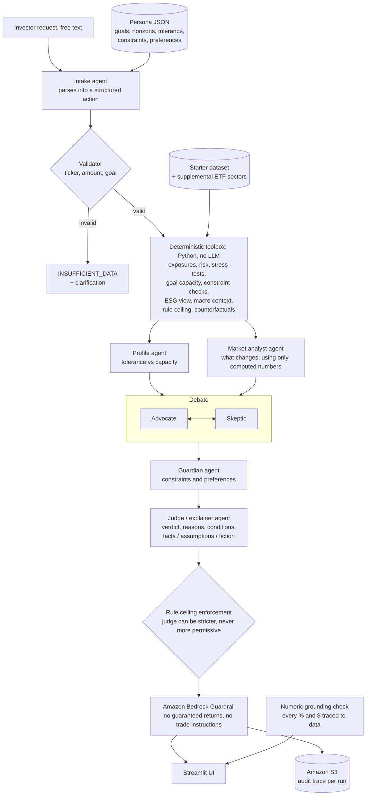

# SecondLook: technical documentation

**PolyFinances Datathon 2026, AlphaForge AI challenge, Team 10**

> Simulation only. No real transactions, no personalised financial advice, no real client or banking data.
> All personas and portfolios are fictional. Historical figures describe the past and do not predict future results.

---

## 1. Problem we chose

Self-directed investors (no advisor) often arrive with an idea: "everyone talks about Tesla", "AI is the future", "Exxon pays a great dividend". Brokerage platforms show the security. They do not show whether the idea is coherent with the investor's **own** goals, horizons, constraints and preferences.

The brief asks exactly this of Robert: *"Can the system challenge a request that conflicts with the investor's profile? … avoid simply agreeing."*

**SecondLook** is a decision-support tool, not a stock picker. Input: a fictional profile, a fictional portfolio and a free-text request. Output: a **coherence verdict** with the evidence behind it.

| Verdict | Meaning |
|---|---|
| ✔ CONSISTENT | No hard constraint or goal limit breached, before or after |
| ◐ CONSISTENT WITH CONDITIONS | Creates no new breach, but a pre-existing gap remains or a preference is worsened |
| ✖ INCONSISTENT | Creates or worsens a breach of a hard constraint or a goal's risk limit |
| ? INSUFFICIENT DATA | Request out of scope or missing key information |

Each verdict comes with:
- the specific reasons,
- "this conclusion no longer holds if…" conditions,
- **computed** variants of the same idea (smaller amount, different funding, a swap),
- before/after exposures and stress tests,
- a labelled split of facts, assumptions, fictional elements and limits,
- a full audit trace.

---

## 2. Architecture

### Why each agent exists

| Component | Kind | Why it exists |
|---|---|---|
| Intake agent | LLM | Turns free text ("move $60k from my bond fund into Tesla") into a structured action. Can refuse manipulation or out-of-scope requests. |
| Toolbox | Deterministic | Single source of every number. LLMs never compute figures. |
| Rules engine | Deterministic | Hard constraints, goal capacity, verdict ceiling, counterfactual variants. Governance cannot be talked out of a rule. |
| Profile agent | LLM | Explains the gap between risk **tolerance** (willingness) and **capacity** (horizon, liquidity). |
| Market analyst | LLM | Explains what changes (sector, geography, currency, volatility, stress) using only toolbox output. |
| Advocate and Skeptic | LLM ×2, 2 rounds | Steel-man both sides, so the verdict is not one-sided. Concessions are recorded. |
| Guardian | LLM over deterministic checks | Governance view: constraints vs preferences, short-horizon speculation, ESG data gaps. |
| Judge / explainer | LLM | Weighs everything and writes the explanation for the reader's knowledge level. |
| Ceiling enforcement | Deterministic | The final verdict can never be more permissive than the rules allow. |
| Grounding check | Deterministic | Every percentage or dollar figure the agents write must match a value in the data (within rounding). Unmatched figures are flagged. |
| Bedrock Guardrail | AWS managed | Last responsible-output screen on every user-facing string. |

A full run makes 9 LLM calls, about 20k tokens and 11 to 16 seconds. Profile and analyst run in parallel, and so does each debate round.

---

## 3. AWS services (qualifying requirement)

| Service | Role in the flow | Why this service |
|---|---|---|
| **Amazon Bedrock**, model `global.amazon.nova-2-lite-v1:0` (Converse API) | All 9 agent calls | Small, fast, low-cost model recommended by the workshop. Accuracy measured in §8 is sufficient, so no larger model is needed. Model is configurable via `BEDROCK_MODEL_ID`. |
| **Amazon Bedrock Guardrails** (`secondlook-responsible-output`) | Screens every user-facing string. **Blocks:** guaranteed-return claims, word filters, PII (SIN, card, bank account). **Detects and logs without blocking:** trade-instruction language (see §8) | Enforces the simulation-only boundary independently of the prompts. |
| **Amazon S3** (`secondlook-<account>-us-east-1`; private, versioned, SSE-encrypted, public access blocked) | One JSON audit trace per analysis (`traces/<date>/<persona>/<run_id>.json`); copy of market inputs | Reproducibility and governance. Any verdict can be re-examined later. |

Provisioning is idempotent: `scripts/setup_aws.py`. Credentials are never stored in the repo; the code uses the standard AWS credential chain.

**Best practices:**
- least data: no PII is processed, and the guardrail blocks PII
- encrypted, private bucket with versioning
- retries with adaptive backoff
- a small model first, with measured accuracy

---

## 4. Data

### 4.1 Sources

| Data | Source | Date | Used for |
|---|---|---|---|
| Daily prices, `adj_close` (31 assets) | AlphaForge starter pack: Yahoo Finance via yfinance | 2021-11-12 to 2026-11-12, retrieved 2026-11-13 | Volatility, drawdowns, risk units, historical stress replays |
| USD/CAD | Starter pack: Bank of Canada Valet FXUSDCAD | same window | Convert USD assets to CAD |
| Policy rate, GoC 2y/10y, CPI (CA), US rates | Starter pack: Bank of Canada Valet, FRED | same window | Cash accrual, macro context, real cash yield |
| Asset universe and GICS sectors | Starter pack `assets_universe.csv` | static | Sector of single stocks, asset class |
| ETF sector weights: XIU.TO, SPY, QQQ, ESGV | **Supplemental**: Yahoo fund breakdown via yfinance | snapshot, see `data/supplemental/etf_sector_weights.json` | Sector concentration and ESG (Energy) look-through |
| Personas and portfolios | **Fictional**, based on the official brief (Amira, Mateo, Robert) + one optional scenario (Maya) | n/a | Context |

### 4.2 Processing (`src/analytics.py`)

1. `adj_close` (splits + dividends) is used for total-return series. The starter-pack warning about split rows was respected: no split is re-applied.
2. USD prices are converted to CAD with the Bank of Canada rate, carried forward over Canadian holidays.
3. **Calendar alignment:**
   - union calendar of all assets (crypto trades 7 days a week);
   - prices carried forward at most 4 days;
   - risk metrics on **weekly Friday closes**, labelled by the last real trading date.
4. `CASH` is a synthetic line that accrues the BoC overnight target daily (assumption: a high-interest savings account earns about the policy rate).
5. **Risk units** = an asset's weekly annualised volatility ÷ SPY's, both in CAD over the full window (SPY = 1.0). For example: ZST 0.03, XBB 0.44, SPY 1.00, NVDA 3.14, BTC 3.40, TSLA 3.74, SHOP 4.37, ETH 4.40.
6. **Macro point-in-time:** monthly CPI is dated to its reference month. We only use months published by the as-of date, assuming a 50-day lag. On 2026-11-12 the latest usable Canadian CPI is September 2026 (3.1% y/y). The real cash yield is about 2.5% − 3.1% = −0.6%.

### 4.3 Known data limits

- **Survivorship bias:** the universe was chosen in 2026 from today's large names.
- **CNQ.TO split row:** the 1.021 "split" on 2022-08-22 is probably a special distribution. We do not apply split rows, and CNQ is not used in personas.
- **FRED values** are latest-vintage (revised), not as first published.
- **ETF sector weights** are a single recent snapshot applied to the whole window.
- **ESG data:** there are no ESG scores or controversy data. Controversy status is always reported as **"not verified"**.
- **Five years** is one cycle. It includes 2022, when stocks and bonds fell together, but no deeper crisis.

---

## 5. Methods and assumptions

### 5.1 Goal capacity vs tolerance (core rule)

Each goal's money gets an **equity-equivalent risk** score: Σ(value × risk units) ÷ goal value, with SPY = 100%.

The limit is the lower of:
- **capacity**, from the horizon: <1y 5%, 1–3y 20%, 3–5y 65%, 5–10y 85%, 10y+ 150%;
- **tolerance**, from the stated profile: low 55%, low-moderate 65%, moderate 85%, high 150%.

**Derivation (assumption):**
- Start from a classic maximum equity share E per horizon, following the kickoff's guidance: under 3 years you cannot ride out a cycle, 3–10 years partially, 10+ years you can.
- The rest of the money is assumed to sit in core bonds at about 0.45 risk units. So limit = E + (1−E) × 0.45.
- Under 3 years, the rest is assumed to be in short-term instruments.
- Above 100% is only reachable with a long horizon and high tolerance. That leaves room for a high-volatility sleeve; it is **not** "anything goes".

Stated horizon ranges use their **lower bound** (conservative): Robert 3–5 → 3, Mateo 8–12 → 8.

### 5.2 Constraints vs preferences

**Hard constraints** are limits. Breaching them, or making an existing breach worse, gives INCONSISTENT. They are:
- minimum cash and cash-equivalents (emergency fund);
- maximum single security;
- maximum crypto;
- maximum sector (look-through);
- excluded asset classes;
- excluded sectors for direct holdings.

**Soft checks** are preferences. Worsening one gives CONSISTENT WITH CONDITIONS, never a veto. They are:
- Robert "values stability": no extra weight in single names over 2× S&P 500 volatility;
- Mateo "little interest in speculation": no extra weight in single names over 3×;
- Mateo's ESG look-through: indirect Energy exposure through funds should not increase.

Every constraint shows its **origin**: *stated* in the brief, or *derived (assumption)*, for example Amira's 50% sector cap from "does not want to invest exclusively in technology". The UI marks derived constraints as assumptions to confirm with the investor.

### 5.3 Verdict ceiling and counterfactuals (`src/rules.py`)

The same logic applies to every check:
- creates or worsens a breach → **INCONSISTENT**;
- leaves a pre-existing breach unchanged or reduced, or worsens a soft check → **CONSISTENT WITH CONDITIONS**;
- otherwise → **CONSISTENT**.

The judge LLM may be more cautious than the ceiling, but only by naming a specific issue ("Beyond the rules: …"). It can never be more permissive; this is enforced in code.

**Counterfactual variants are computed, not generated.** They are:
- (a) the same idea funded with new money,
- (b) a swap that trims the largest single-security position in the same goal,
- (c) the largest amount, by bisection, that does not create an INCONSISTENT result.

Each variant is re-evaluated with the same rules.

### 5.4 Stress tests

- **Hypothetical shocks (labelled assumptions):**
  - severe equity bear market;
  - stocks and bonds falling together (TLT hit harder, ZST spared);
  - tech/AI sell-off (sector look-through);
  - Canada-specific downturn;
  - CAD +10%;
  - crypto winter.
- **Historical replays (facts from the data):**
  - 2022, stocks and bonds fell together (2022-01-03 to 2022-10-12);
  - the 2021–22 crypto winter;
  - the worst S&P 500 and Nasdaq-100 drawdowns found in the sample, detected automatically and de-duplicated.

---

## 6. Explainability

Every analysis shows:
- the interpreted action;
- the verdict with confidence;
- key reasons;
- "no longer valid if…";
- computed variants;
- facts / assumptions / fictional / limits as four labelled lists;
- before/after charts;
- each constraint with its origin;
- the agent debate including concessions;
- the audit trail: per-step latency and tokens, the grounding score, guardrail results, S3 location, data provenance, and every agent's raw JSON output.

We show **what each agent concluded and on which data**, not hidden model reasoning, as the brief requires.

### Worked example: a conclusion traced to data (run `4fb9c8feac21`, stored in S3)

Robert asks: *"Everyone is talking about Tesla. I want to move $60,000 from my XBB bond fund into TSLA."*

| Conclusion | Evidence (toolbox output) | Source |
|---|---|---|
| Retirement money would exceed its risk limit | Equity-equivalent risk 56% → **111%**; limit **65%** (3-year horizon, low-moderate tolerance) | Risk units from starter prices; rule §5.1 |
| Breaks the single-security limit | TSLA would be **15.6%** of the portfolio vs a 10% cap | Fictional holdings + rule |
| TSLA is far more volatile than his usual holdings | TSLA volatility **55.8%/yr** = **3.74×** SPY; max drawdown **−68.2%** (low on 2023-01-06); worst 12 months **−64.8%** | `prices_daily.csv`, adj_close, CAD, 2021-11-12 to 2026-11-12 |
| Portfolio would behave very differently | Portfolio volatility 5.0% → 10.7%; max drawdown −9.4% → −16.6%; 2022 replay −9.8% → −14.0% | Historical replay on starter data |
| A smaller version is closer to his profile | $10,000 variant: within limits, but conflicts with his stated preference for stability → ◐ | Computed counterfactual |

**Execution facts:**
- 9 LLM calls, 23.6k tokens, 15.9 s;
- grounding 26/26 figures traced to data;
- guardrail checked 12 strings and blocked 0;
- trace at `s3://secondlook-381491974104-us-east-1/traces/2026-11-14/robert/4fb9c8feac21.json`.

---

## 7. Personas and what each one tests

| Persona | Brief's test | Example request | SecondLook result |
|---|---|---|---|
| **Robert**, 59, low-moderate, 3–5y | Challenge a hyped request | $60k from XBB into TSLA | ✖: breaks the risk budget and single-name cap. Variant $10k → ◐ (preference conflict) |
| | | $20k from XBB into JNJ | ✔ |
| **Amira**, 26, high, 15y+ | High risk ≠ anything goes | $15k new money into NVDA | ✖: single-name 28.7% > 15%; tech 59% > 50%; risk 133% → 184% > 150%. Variant about $3.75k → ✔ |
| | | $2k into ETH / $10k into XIU | ✔ / ✔ |
| **Mateo**, 41, moderate, 8–12y, ESG | Non-financial criteria | $10k into XOM | ✖: Energy exclusion |
| | | Switch $20k ESGV → SPY | ◐: indirect fossil-fuel exposure via SPY rises (2.1% → 2.6% of the portfolio) |
| | | $10k into ESGV | ✔ |
| **Maya**, 27, optional near-term purchase | Tolerance ≠ capacity | $15k of condo money into QQQ | ✖: condo goal 12% → 65% vs 20% |

---

## 8. Validation

1. **Deterministic tests** (`pytest`, 29 tests):
   - expected rule outcomes for every persona scenario;
   - personas start within their limits;
   - data window and currency;
   - the risk-unit ordering;
   - CPI publication lag;
   - value conservation on swaps;
   - ESGV has no Energy, SPY does;
   - ceiling enforcement.
2. **End-to-end evaluation** (`scripts/evaluate.py`, results in [`evaluation.md`](evaluation.md)):
   - 14 cases × 2 repeats with live Bedrock calls;
   - measures exact verdict accuracy, safety (never more permissive than expected), intake accuracy, stability across repeats, numeric grounding, guardrail interventions and latency;
   - includes a prompt-injection case, an out-of-universe security and an ambiguous request.
3. **Iterations driven by evaluation**, recorded honestly:
   - The first evaluation reached 17/24. The judge was too strict and inconsistent, and the guardrail over-blocked.
   - We then added verdict definitions, symmetric breach rules, "use the ceiling unless you name a specific extra issue", a narrower guardrail topic, and audit of blocked originals.
   - The second run reached 23/24 exact and 24/24 safe.
   - The pipeline was then re-based on the official starter data and personas.
4. **Current results** (14 cases × 2 repeats, live Bedrock):

   | Metric | Result |
   |---|---|
   | Exact verdict | 28/28 |
   | Never more permissive than expected | 28/28 |
   | Intake picked the right security | 28/28 |
   | Same verdict on both repeats | 14/14 cases |
   | Figures traced to data | 597/598 |
   | Judge corrected by the ceiling | 0 |
   | Guardrail blocks after calibration | 0 (detections logged) |

5. **Guardrail calibration:**
   - In that run, the *Trade execution instructions* topic blocked 12 strings. Every one was a false positive: an analysis of the investor's own proposed trade, such as "The proposed $15,000 investment in NVIDIA breaches two hard constraints".
   - We switched that topic to **detect-only**, so it is logged in the trace and shown in the audit tab.
   - Guaranteed-return claims and PII still block.
   - Rationale: the brief warns against hiding information. The prompts already forbid trade instructions, and every detection stays visible for review.

---

## 9. Limitations

- Rules are **simplified, documented assumptions**, not regulatory suitability rules. Horizon and tolerance limits are rules of thumb.
- **Volatility is one risk indicator.** It misses tail and liquidity risk, and a 5-year window is one cycle.
- **One action at a time.** No multi-step plans, taxes or account types (TFSA/RRSP).
- **Look-through is approximate.** ETF sectors are a snapshot, and geography and currency come from issuer descriptions.
- **ESG controversies are not verified.** The fossil-fuel screen is a sector proxy.
- **LLM variability:** verdicts can differ between repeats (measured). The rule ceiling bounds the risk to "too cautious", never "too permissive".
- **The guardrail's trade-instruction classifier over-triggers** on descriptive analysis, so it runs in detect-only mode. Blocked or flagged originals are kept in the audit trail.

## 10. Improvements we would make next

- Verified ESG and controversy evidence: issuer methodology pages, sustainability reports, SEDAR+/EDGAR, with citations.
- Multi-action plans, with the investor confirming derived constraints in a dialogue.
- Bedrock Knowledge Base over regulatory education content (e.g. CIRO investor guides) to cite definitions.
- Deployment behind authentication (App Runner or ECS) with CloudWatch metrics on verdict drift.
- A larger model only where evaluation shows a measurable gain.

---

## Reproduce

See the [README](../README.md).
